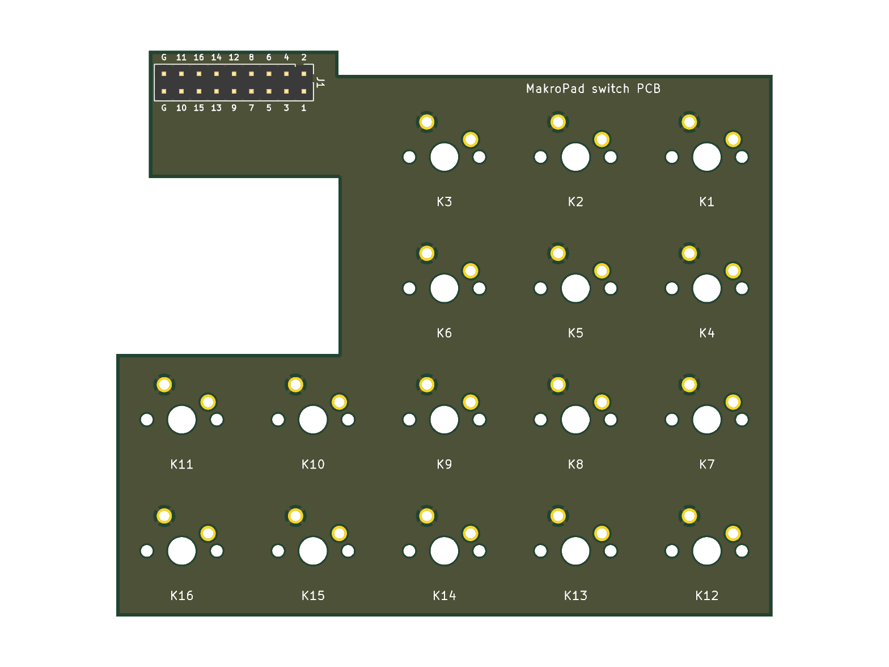

# MakroPad Switch-Platine

2-lagige Platine für die 16 MX-Switches, direkt eingelötet. Jede Taste hat eine eigene Leitung
zum Stecker J1, der zweite Pin liegt auf GND (Masseflächen oben und unten). Keine Matrix, keine
Dioden: passt ohne Firmware-Änderung zu `config::ButtonPins`.



Die Platine wird von [makropad_switch_pcb.py](makropad_switch_pcb.py) erzeugt, die Maße kommen aus
[../case/makropad_case.scad](../case/makropad_case.scad) (oben im Skript, bei Gehäuseänderungen mitziehen).

```powershell
& "D:\Program Files\KiCad\10.0\bin\python.exe" makropad_switch_pcb.py
$k = "D:\Program Files\KiCad\10.0\bin\kicad-cli.exe"
& $k pcb drc --severity-all makropad_switch.kicad_pcb
& $k pcb export gerbers --layers "F.Cu,B.Cu,F.Mask,B.Mask,F.SilkS,B.SilkS,Edge.Cuts" --subtract-soldermask --no-x2 -o export\gerber makropad_switch.kicad_pcb
& $k pcb export drill --format excellon --excellon-separate-th -o export\gerber\ makropad_switch.kicad_pcb
Compress-Archive -Force -Path export\gerber\* -DestinationPath export\makropad_switch_jlcpcb.zip
```

## Bestellen (JLCPCB)

`export/makropad_switch_jlcpcb.zip` hochladen. 2 Lagen, 1.6 mm, sonst Standard. Keine Bestückung nötig
(nur THT). Die Platine ist ca. 95 × 82 mm.

## Stecker J1 → ESP32-S3-DevKitC-1

2×9-Stiftleiste (2.54 mm), Kunststoff auf der **Unterseite**, Stifte zeigen nach unten.
Alternativ Kabel direkt einlöten. Die Unterseite ist mit den Tastennummern beschriftet:

| J1 | 1 | 2 | 3 | 4 | 5 | 6 | 7 | 8 | 9 | 10 | 11 | 12 | 13 | 14 | 15 | 16 | G |
| --- | --- | --- | --- | --- | --- | --- | --- | --- | --- | --- | --- | --- | --- | --- | --- | --- | --- |
| GPIO | 4 | 5 | 6 | 7 | 10 | 11 | 12 | 13 | 14 | 15 | 16 | 17 | 18 | 21 | 39 | 40 | GND |

Beide `G`-Pins sind GND, einer reicht.

## Einbau

1. Switches in die Switch-Platte klicken (3- oder 5-Pin, die Löcher passen für beide).
2. Platine von unten auf die Switch-Pins setzen, satt anliegend verlöten.
3. Stiftleiste von unten einsetzen und verlöten (oder Kabel).
4. Switch-Platte samt Platine wie im Gehäuse-README in den Deckel schrauben. Die hintere
   Laschen-Schraube bleibt hinter der Platinenkante erreichbar.

Die Aussparung rechts hinten ist der Durchgang für die OLED-Kabel. Die Lasche mit J1 sitzt rechts
neben dem ESP32 (dort ist unter der Platine ca. 19 mm Platz).

Platz geprüft (OpenSCAD, Platine + 1.8 mm Lötspitzen + Stiftleiste gegen Schale, Deckel,
Switch-Platte, OLED-Rahmen und ESP32 mit 3.3 mm Bauteilhöhe): keine Kollision, über dem ESP32
bleiben 0.5–1 mm. Lötspitzen nach dem Löten kurz abknipsen.
